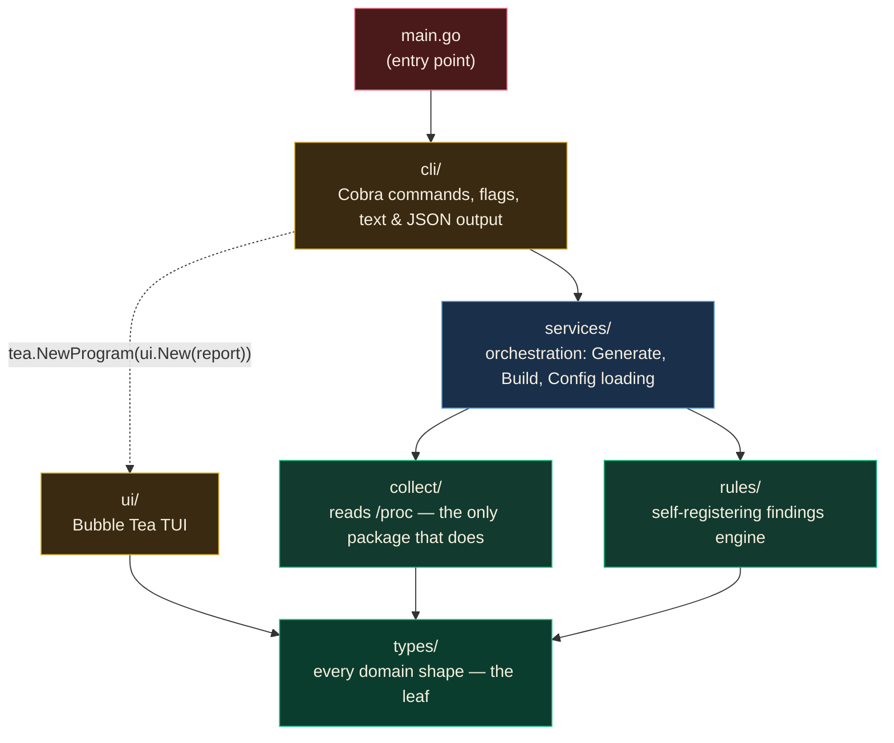
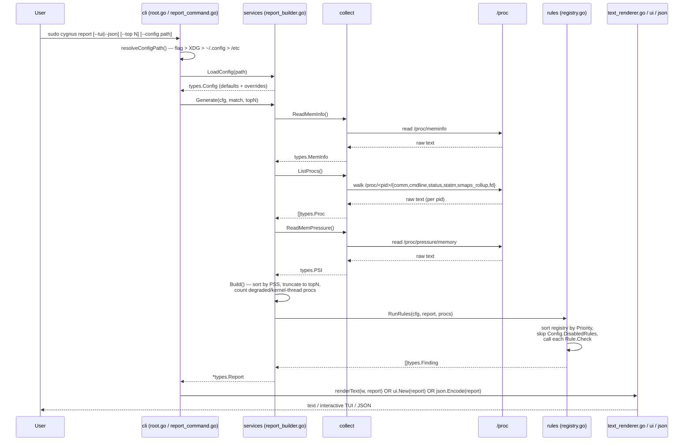

# Architecture

How a `cygnus report` invocation moves through the codebase, end to end.

## Entry point

**[`main.go`](../main.go)** is the only entry point. It does one thing:
call `cli.Execute()` and exit non-zero on error. All real work happens
inside the `cli` package and below.

## Package graph

Dependencies flow one direction only — enforced by import discipline, not
tooling. `types` is the leaf: it imports nothing internal and nothing
external beyond the stdlib.

`cli` and `ui` never import `collect` or `rules` directly — everything
goes through `services`. That's not a suggestion; nothing in `cli`/`ui`
has a reason to import them, so the boundary holds naturally.

## Request flow: `cygnus report`

## Package responsibilities

| Package | Owns | Never does |
| --- | --- | --- |
| [`types/`](../types) | Every domain shape: `MemInfo`, `PSI`, `Proc`, `Finding`, `Report`, `Config`, `Rule`. | Logic, I/O, imports of any other internal package. |
| [`collect/`](../collect) | Reading and parsing `/proc`. One `*_reader.go` per source, each splitting I/O (`ReadX`) from pure parsing (`parseX`/`readX`). | Correlation, thresholds, rendering. |
| [`rules/`](../rules) | The findings engine: `registry.go` (register/run) + one self-registering file per check. | Collecting data, rendering, orchestration. |
| [`services/`](../services) | Orchestration: wiring `collect` + `rules` into a `Report` (`report_builder.go`); config loading behavior (`config_loader.go`). | Rule logic, type definitions, `/proc` access. |
| [`cli/`](../cli) | Cobra command/flag wiring, text rendering, config-path resolution. | Touching `/proc` or `rules` directly. |
| [`ui/`](../ui) | Bubble Tea rendering of a `*types.Report`. | Touching `/proc`, correlation, mutating the report. |
| [`utils/`](../utils) | Stateless unit-conversion helpers (KiB → GB/MB). | Everything else — imports nothing internal. |

## Extending Cygnus

**Add a new finding:** create `rules/your_check.go` with a `Check` function
and an `init()` that calls `Register(types.Rule{...})`. No other file
changes — see [`rules/thread_explosion.go`](../rules/thread_explosion.go)
for the shortest example.

**Add a new tunable threshold:** add a field to `types.Config`
([`types/config.go`](../types/config.go)), a default in
`services.DefaultConfig()` ([`services/config_loader.go`](../services/config_loader.go)),
and reference `cfg.YourField` from the rule that needs it.

**Add a new `/proc` source:** add `collect/your_reader.go` following the
`ReadX` (I/O) / `parseX` (pure) split used by the existing readers, and a
matching shape in `types/`.

**Add a new TUI panel:** add a `renderYourPanel` function in
[`ui/view.go`](../ui/view.go) and call it from `Model.layout()` in
[`ui/model.go`](../ui/model.go); pull colors from the `Tier`/`tierPalette`
table in [`ui/theme.go`](../ui/theme.go) rather than hardcoding new ones.
